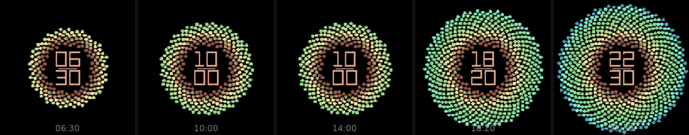

# Phyllotaxis — a Pebble watchface

A golden-angle seed spiral that grows as the day passes. At midnight the dial is
blank; every seed added from then on takes its hue from the hour it represents,
so by evening the dial is a dense sunflower head that is also a record of the
day.

```
radius(n) = sqrt(r_in² + k·n)      angle(n) = n · 137.50776405°
```

`k` is chosen so the seeds fill the annulus with *uniform* area density. The
naive `r = r0 + c·√n` crams every seed against the inner edge (the constant
offset breaks the uniform-density property of the spiral), which is why the
first build looked like mush at the hub.



## What a seed encodes

| Property | Meaning |
| --- | --- |
| Position | the minute it represents — the spiral is a clock, unwinding outward |
| Hue | walks a half wheel over the day: amber at midnight → green at noon → blue by the next midnight |
| Brightness | a sun curve, dim at midnight and full at noon |
| Freshness | the leading edge is always "now" — nothing is redrawn, seeds are never moved |

Seed diameter follows the lattice pitch: `0.72 × pitch`, which is the largest
circle that still leaves black space between neighbours.

## Two builds

`SEED_MINUTES` sets how much time one seed stands for.

| Build | Seeds/day | Lattice | Seed |
| --- | --- | --- | --- |
| `phyllotaxis-2min.pbw` | 720 | 8.0 px | 6 px circle |
| `phyllotaxis-1min.pbw` | 1,440 | 5.4 px | 3 px plus |

The one-a-minute version is the original concept, but 1,440 seeds on a 260 px
dial sit on a 5.4 px lattice — and the largest circle that keeps a gap at that
pitch is 4 px, which rasterises as a plus sign. One seed per two minutes doubles
the pitch and buys genuine 6 px circles. That is the whole of the trade-off.

## Layout

* Hub: `HH` over `MM`, LECO 28 light, hairline rule between, on a hard circular
  void so the inner edge of the field is a clean circle rather than a scallop of
  half-drawn seeds.
* No battery, date or step bar on the dial — the field is the information.
* Bluetooth disconnected dims the field; battery ≤ 15 % dims it again.

## Build

```bash
pebble sdk install latest     # once
pebble build                  # -> build/pebble-phyllotaxis.pbw
```

Targets: `gabbro` (Round 2, 260×260), `emery` (Time 2), `chalk` (Time Round,
180×180), `basalt`, `diorite`, `flint`, `aplite`.

## Run it in the emulator

```bash
pebble install --emulator gabbro dist/phyllotaxis-2min.pbw
pebble emu-set-time --emulator gabbro 18:20:00   # watch the field grow
pebble screenshot --emulator gabbro --no-open shot.png
```

`emu-set-time` only takes `HH:MM:SS` or unix seconds — a date string is rejected.

## Offline preview renderer

`tools/preview.py` parses the palette constants straight out of
`src/c/phyllotaxis.c`, so previews cannot drift from the firmware.

```bash
python3 tools/preview.py --minute 1100 --scale 3 --out renders/one.png
python3 tools/preview.py --grid 4 --out renders/day.png
```

Note that the offline renderer shows considerably more saturated colour than the
emulator does — the emulator applies a display LUT that desaturates hard. Trust
the emulator, not the preview, for colour decisions.

## Gotchas found the hard way

* `graphics_draw_pixel` uses the **stroke** colour, not the fill colour — 1 px
  seeds drawn with it are invisible on black. Use a 1×1 `graphics_fill_rect`.
* A rounded rect with corner radius = half its side renders as a `+` at 3–5 px.
  Explicit row tables are the only way to get round seeds.
* Two separate `graphics_draw_text` calls drift apart by a dozen pixels, because
  each box is positioned from the top of its line box while the glyphs sit below
  the leading. Give each box two lines of height and compensate for the leading.
* A `\n` inside a full-width box is laid out as a space. Word-wrap mode is
  required for a hard break.
* `graphics_draw_arc(ctx, rect, GOvalScaleModeFillCircle, start, end)` — the
  rect comes *before* the scale mode, and the angles are `int32_t`. Casting to
  `int16_t` overflows above 50 % of a full turn.
* `M_PI` is not defined by the Pebble toolchain's `math.h`.
* `pebble build` prints `Waf: Leaving directory` even when the compile failed.
  Grep for `error:` or `finished successfully`, never for the Waf line.

## Dithering

`DITHER 1` halftones each blob between the two nearest palette entries, which
buys back roughly two bits per channel in theory. At a 6 px seed it is a
visible clover texture and the dot stops reading as a circle, so it is off by
default. It would pay off at ~9 px seeds (one per three minutes).